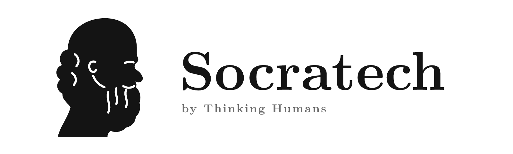
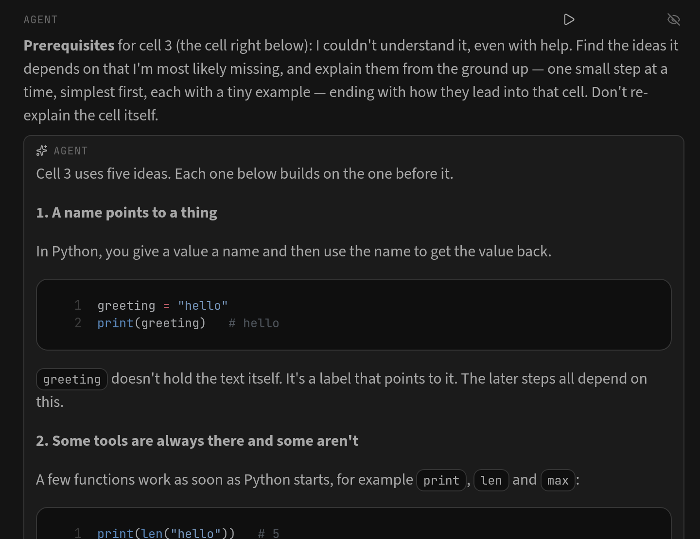

<p align="center">
  <picture>
    <source media="(prefers-color-scheme: dark)" srcset="docs/assets/socratech_banner_dark.png">
    <source media="(prefers-color-scheme: light)" srcset="docs/assets/socratech_banner_light.png">
    
  </picture>
</p>

<p align="center"><strong>Learn it. Then publish it.</strong></p>

<p align="center">
  <a href="https://thinkinghumans.world/socratech">Website</a> ·
  <a href="#how-it-works">How it works</a> ·
  <a href="#run-it">Run it</a> ·
  <a href="docs/README.md">Documentation</a> ·
  <a href="https://github.com/Thinking-Humans/socratech/issues">Issues</a>
</p>

Socratech is a learning notebook with a Socratic agent built in. You write and run cells the way you would in Jupyter. When a cell stops making sense, you say so, and the agent finds the ideas you're missing and builds them up one small step at a time. What you learn can then go out as a post on your own site.



## How it works

1. **Write and run.** Notebooks mix markdown and code cells. Python runs in a persistent per-notebook kernel and C++ compiles with `g++`. Markdown cells can embed images and video.
2. **Rate your understanding.** Mark any cell *on my own*, *with help*, or *couldn't, even with help*. The agent can cross-check a rating against what you wrote.
3. **Fill the gaps.** "Couldn't, even with help" adds a prerequisites agent cell. It finds the ideas the cell depends on that you're most likely missing and explains them simplest-first, each with a tiny example.
4. **Ask in place.** Agent cells (`Mod+L`) answer with the whole notebook as context. `/ask` in a cell, or highlight a passage and ask inline to insert or explain.
5. **Publish.** Send a notebook to your own site repo as a Markdown post or a `.ipynb`. Attempts, verdicts and private asides stay private unless you choose to publish a cell. Socratech shows the diff, then commits and pushes with your own git credentials only after you confirm.

## Knowledge that carries forward

Each cell can feed a knowledge graph of the ideas it contains, on request or when you publish. Every cell is its own source: editing a cell replaces what it contributed, and deleting it withdraws it. A published post becomes the provenance for the ideas it taught.

## Also in the box

- **Jupyter-style keys.** `Mod+B` code cell, `Mod+M` markdown, `Esc`/`Enter`/arrows to move. All shortcuts can be rebound. `Mod+K` searches every notebook.
- **Your models.** Provider API keys, an installed [Claude Code CLI](docs/claude-code.md), or a [custom OpenAI-compatible endpoint](docs/custom-providers.md), including a local model server.
- **Teaching engine.** Socratech is built on LearnHarness's teaching engine (measure → plan → teach → practice). Its session views are currently hidden while the notebook is the main surface.

## Your keys, your data

- **No subscription or markup.** Billing depends on your provider, CLI or local setup.
- **Local storage.** Notebooks, the graph, settings and API keys live on your machine as plain files you can inspect.
- **External services.** Models run through the providers you configure, and publishing pushes to the repo you choose. Local storage does not mean offline processing.
- **Inspectable behavior.** System prompts are visible and editable. The app is open source under AGPL-3.0.

## Run it

```bash
npm ci
npm run plugins:setup
npm run dev        # http://localhost:3000
npm test           # fixtures and fake providers
```

Desktop builds (macOS, Windows, Linux) will be published on [GitHub Releases](https://github.com/Thinking-Humans/socratech/releases).

See the [documentation index](docs/README.md) for guides, [development](docs/development.md) for setup and checks, [architecture](docs/architecture.md) for the runtime, [keyboard shortcuts](docs/keyboard.md), and [learn in public](docs/learn-in-public.md) for the notebook and publishing design.

## Support

- Questions, bugs and feature requests: [GitHub Issues](https://github.com/Thinking-Humans/socratech/issues).
- Security vulnerabilities: report privately as described in [SECURITY.md](SECURITY.md), not in public issues.
- Contributing: see [CONTRIBUTING.md](CONTRIBUTING.md).

## Credits and license

Socratech is made by [Thinking Humans](https://thinkinghumans.world). It is a modified fork of [LearnHarness](https://github.com/amosblomqvist/learnharness) by Amos Blomqvist and contributors, modified since 2026-11-13 and tracking upstream (currently v0.6.1). Socratech is not affiliated with or endorsed by the LearnHarness project.

Licensed under [AGPL-3.0](LICENSE), like the original. If you run a modified Socratech for other people over a network, you must offer them its source.
